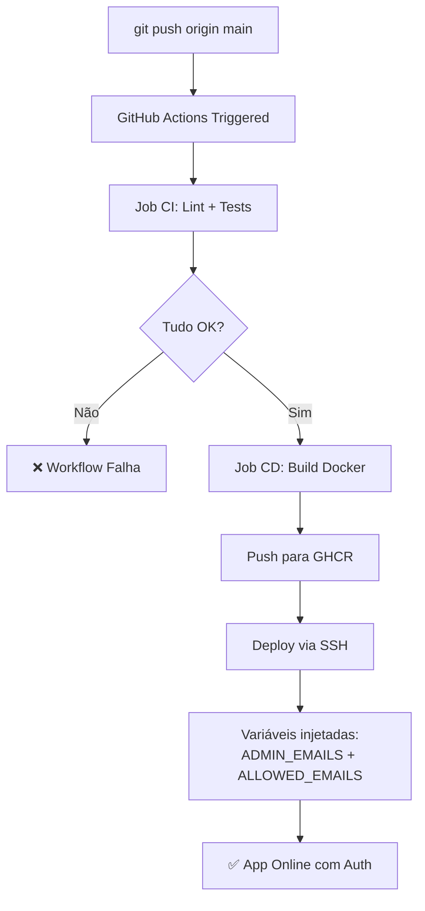

# 🔑 Guia: Configurar GitHub Secrets para Autenticação

## 📍 Localização no GitHub

1. Acesse seu repositório no GitHub: `https://github.com/92username/atc-cap-v2`
2. Clique em **Settings** (engrenagem no topo à direita)
3. No menu lateral, clique em **Secrets and variables** → **Actions**

## ➕ Criar Secrets

### Secret 1: `ADMIN_EMAILS`

1. Clique em **"New repository secret"**
2. **Name**: `ADMIN_EMAILS`
3. **Value**: Digite os e-mails de administradores separados por vírgula
   ```
   seu-email@airmail.com,outro-admin@airmail.com
   ```
4. Clique em **"Add secret"**

### Secret 2: `ALLOWED_EMAILS`

1. Clique em **"New repository secret"**
2. **Name**: `ALLOWED_EMAILS`
3. **Value**: Digite os e-mails de usuários autorizados separados por vírgula
   ```
   usuario1@airmail.com,usuario2@airmail.com
   ```
4. Clique em **"Add secret"**

## ✅ Verificar Configuração

Após adicionar os secrets, você deve ver na página:

```
ADMIN_EMAILS          Updated 1 second ago
ALLOWED_EMAILS        Updated 1 second ago
```

## 🚀 Testar

1. Faça um commit e push para a branch `main`:
   ```bash
   git add .
   git commit -m "feat: add authentication"
   git push origin main
   ```

2. Vá para a aba **Actions** do repositório
3. Você verá o workflow `CI/CD - TATIC Processor` executando
4. Aguarde a conclusão (deve levar ~2-3 minutos)
5. Quando terminar com sucesso ✅, seu app terá autenticação ativada

## 🔍 Verificar Logs do Deploy

1. Na aba **Actions**, clique no workflow em execução
2. Clique em **cd** (job de CD/Deploy)
3. Role até **"Deploy via SSH na VPS Hostinger"**
4. Você verá os logs do deploy e confirmação de sucesso

## 🧪 Testar Autenticação

1. Acesse `http://seu-vps-ip:8506`
2. Você verá a tela de login 🔐
3. Digite um dos e-mails configurados
4. Clique em "Entrar"
5. Deve exibir "Acesso permitido. Bem-vindo!" ✅

## ❌ Se algo der errado

### Cenário 1: "Acesso negado" mesmo com e-mail correto
- Verifique se os secrets foram criados corretamente
- Verifique se o deployment foi bem-sucedido (aba Actions)
- Tente atualizar a página (Ctrl+F5)

### Cenário 2: Workflow falha no CI
- Clique no workflow na aba Actions
- Procure pela falha no job `ci` (linting/tests)
- Execute localmente: `black . && ruff check .`

### Cenário 3: Deploy falha
- Verifique logs SSH na aba Actions
- Verifique se a VPS está online: `ping seu-vps-ip`
- Verifique conexão SSH: `ssh root@seu-vps-ip -i ~/.ssh/id_rsa`

## 📝 Exemplo de Workflow



## 🔄 Atualizar Secrets

Para adicionar/remover e-mails depois:

1. Vá para **Settings → Secrets and variables → Actions**
2. Clique em **Update** ao lado do secret que quer alterar
3. Modifique o valor
4. Clique em **Update secret**
5. Faça um push novo (mesmo que vazio) para `main`

```bash
git commit --allow-empty -m "trigger deploy with updated secrets"
git push origin main
```

## 🛡️ Boas Práticas

✅ **Fazer:**
- Use e-mails específicos, não genéricos (evite `admin@example.com`)
- Revise a lista periodicamente e remova e-mails antigos
- Use separador vírgula sem espaços extras

❌ **Não fazer:**
- Não deixe secrets públicos em comentários do código
- Não commite o arquivo `.env` (já está em `.gitignore`)
- Não compartilhe os valores dos secrets por mensagem

## 📞 Debug

Se precisar debugar os secrets na VPS:

```bash
# SSH na VPS
ssh root@seu-vps-ip

# Ver variáveis de ambiente do container
docker exec tatic-processor env | grep -i email
```

---

**Pronto!** 🎉 Seus secrets estão configurados e o app agora tem autenticação via whitelist de e-mails.
